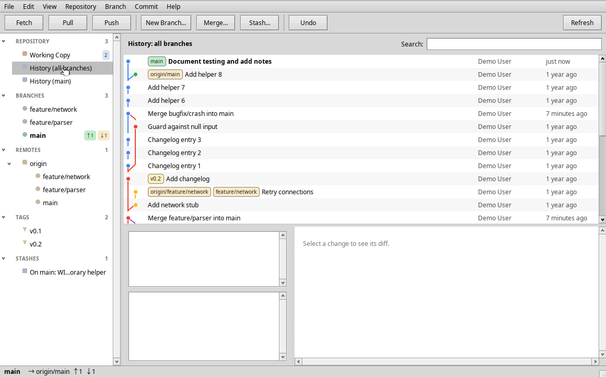

# Turbo Chook


A native Git client for Haiku, modelled on Tower and named after the Tasmanian
nativehen, the flightless bird locals call the turbo chook. It is written in
C++17 against the Interface Kit and drives the system's `git` command, so the
Git version it uses can be chosen from every installation on the machine.

**0.1.2 alpha** builds and runs on Haiku R1/beta6 x86_64. The code has no
architecture-specific parts and is intended to build unchanged on the ARM64
Haiku fork once its toolchain provides the Interface Kit.



<!-- airos-ci:latest-builds:start -->
## Latest builds

Built automatically by air/OS CI from commit `ebe230b` on 2026-10-05 ([all files](https://github.com/jmgasper/turbo_chook/releases/tag/latest)).

| Architecture | Package |
|---|---|
| arm64 | [turbochook-0.1.2.alpha-1-arm64.hpkg](https://github.com/jmgasper/turbo_chook/releases/download/latest/turbochook-0.1.2.alpha-1-arm64.hpkg) |
| x86_64 | [turbochook-0.1.2.alpha-1-x86_64.hpkg](https://github.com/jmgasper/turbo_chook/releases/download/latest/turbochook-0.1.2.alpha-1-x86_64.hpkg) |

Install with `pkgman install <file>`, or copy the file into `/boot/system/packages`. Haiku SDK: x86_64 hrev60206-669-g9dc439ceeb, arm64 hrev60206-669-g9dc439ceeb.
<!-- airos-ci:latest-builds:end -->

## Features

- **Working copy**: unstaged, staged and conflicted files with status badges;
  stage or unstage by drag & drop between the lists, double-click, context menu
  or the Stage All/Unstage All buttons. The diff pane offers *Stage Hunk*,
  *Discard Hunk* and *Unstage Hunk*, and selecting individual added/removed
  lines (click, Shift-click, Alt-click) turns them into *Stage Lines* and
  *Discard Lines*. Commit with a message, amend the last commit, discard
  changes, add untracked files to `.gitignore`.
- **History**: a railway graph of all branches (or one branch, tag, remote or
  stash) with ref badges, author and relative date, incremental loading, and a
  search field over subject, author, body and hash. Selecting a commit shows
  its metadata, changed files with line counts and the per-file diff; selecting
  two commits compares them. The context menu checks out the commit, creates a
  branch or tag at it, cherry-picks it into the current branch, reverts it,
  resets the current branch to it (soft, mixed or hard) or copies the hash.
- **Branches, remotes, tags, stashes, submodules** in the sidebar with
  ahead/behind counters, current-branch highlighting and *gone* upstreams.
  Create, checkout, rename, delete, merge (fast-forward, `--no-ff` or squash),
  rebase, compare, push, force-push with lease, set upstream, fetch, pull
  (merge or rebase), publish, delete remote branches, apply/pop/drop stashes,
  create and push tags, update submodules, continue or abort an in-progress
  merge/rebase/cherry-pick/revert, and resolve conflicts with *Use Ours*,
  *Use Theirs*, *Open in Editor* and *Mark Resolved*.
- **Drag & drop** as in Tower: a branch onto a branch offers *merge into*,
  *rebase onto* and *compare*; a local branch onto a remote pushes or
  force-pushes it; a remote branch onto *Branches* or the working copy creates a
  tracking branch; a commit onto a branch cherry-picks it, onto *Branches*
  creates a branch and onto *Tags* creates a tag; a stash onto the working copy
  applies or pops it; a tag onto a remote pushes it. Files dragged between the
  change lists stage and unstage. A folder dropped from Tracker opens that
  repository.
- **Undo** (Alt+Z or the toolbar button) reverses the last operation: stage,
  unstage, discard (restored from an automatic `git stash create` backup),
  commit, amend, hunk and line changes, branch creation/deletion/rename,
  checkout, merge, rebase, cherry-pick, revert, reset, pull, stash save/apply/
  pop/drop, tag creation/deletion, remote addition/removal.
- **Pull requests** for repositories with a GitHub remote: list open, closed
  or all pull requests, read descriptions, reviews and comments, check the head
  out as a local `pr/N` branch, create a pull request from the current branch
  (pushing it first when needed), merge (merge commit, squash or rebase), close,
  reopen, comment and open it in the browser. A personal access token from
  Preferences authenticates the API and HTTPS pushes to github.com.
- **Git version selection**: Preferences lists every Git found in
  `/boot/system/bin`, `/boot/system/non-packaged/bin`,
  `~/config/non-packaged/bin`, `~/config/bin` and `PATH`, plus any executable you
  add with *Other…*, each with its reported version. The newest is used until
  you pick one; open repositories switch immediately.
- **Look & Feel**: Preferences chooses the font family, point size and a
  colour theme for every window: System (Haiku's Appearance settings) or the
  ten palettes shared with Kiri (Obsidian, Daylight, Nord, Midnight, Forest,
  Ember, Linen, Glacier, Rose, Meadow). Pull request descriptions and comments
  render as Markdown.
- Welcome window with recent repositories, clone and init, Tracker and
  Terminal shortcuts, persistent window frame and sidebar width, and a
  periodic refresh while the window is active that keeps your scroll position,
  selections and collapsed sections.

## Install or build

On Haiku R1/beta6:

```sh
pkgman install ./turbochook-0.1.2~alpha-1-x86_64.hpkg
/boot/system/apps/TurboChook /path/to/repository
```

Turbo Chook appears in Deskbar's Applications menu; opening a folder with it
from Tracker works too. The package requires `cmd:git` and `cmd:curl`.

From source:

```sh
pkgman install gcc make git
make -j4            # build-haiku/TurboChook
make check-host     # portable core tests, also work on Linux with g++
make package        # artifacts/turbochook-0.1.2~alpha-1-x86_64.hpkg
```

`make BUILD=build-host check-host` runs the same tests on a Linux host; they
exercise the parsers, graph layout, diff patch generation, settings and a live
repository through whichever `git` is installed.

## Layout

| Path | Contents |
| --- | --- |
| `src/core/` | Portable core: process runner, Git command layer and parsers, graph layout, unified diff parser and patch builder, GitHub REST client (through `curl`), settings, undo stack, Git installation discovery |
| `src/ui/` | Interface Kit application: welcome, repository window, sidebar, working copy, diff view, history graph, pull requests, preferences, clone and prompt windows |
| `tests/` | Core tests |
| `resources/` | Application resources, package info, branding |
| `tools/` | Icon encoder (`hvif.py`, `make-icon.py`), VM helpers, packaging, demo repository script |
| `docs/` | [VM setup](docs/VM.md), [verification record](docs/STATUS.md) |

Settings live in `~/config/settings/TurboChook/settings.json`.

## Branding

The [application icon](resources/branding/README.md) is a running nativehen
drawn to Haiku's icon guidelines and encoded directly as HVIF by
`tools/make-icon.py`; the SVG and PNG renders next to it are generated from the
same source.

## License

MIT. The bundled `nlohmann/json` header is MIT licensed as well.
