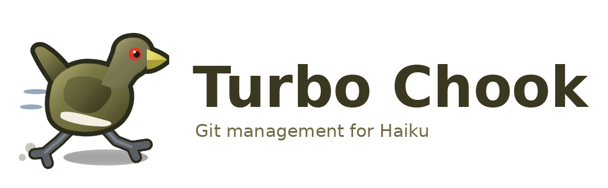
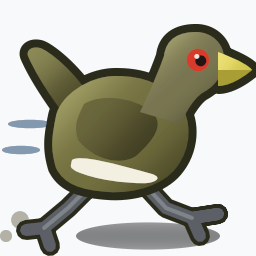
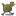
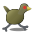
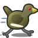
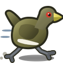
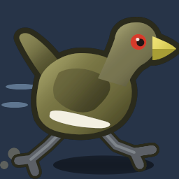

# Turbo Chook branding



## Haiku application icon



The icon is a Tasmanian nativehen (*Tribonyx mortierii*) at full tilt, the bird
Tasmanians call the turbo chook: a plump olive-brown body, a short cocked
tail, a stout yellow-green bill, the red eye and the white flank streak, on
strong grey legs, with motion streaks and a puff of dust behind it.

It follows [Haiku's icon guidelines](https://www.haiku-os.org/development/icon-guidelines/)
and is designed to read from 16 x 16 to 128 x 128:

- 64 x 64 canvas that the bird fills; broad shapes, thick legs, a big head and
  eye so the silhouette survives at 16 px.
- Light from the upper left: body, head, tail and bill gradients run from a
  lighter top-left to a darker lower-right.
- The floor shadow is a soft ellipse extending straight to the right of the feet.
- Level of detail through HVIF visibility scales: the wing, flank streak,
  pupil, motion streaks, leg highlights and dust only render at 32 px and above
  (dust, highlights and the eye glint from 64 px). Below 32 px the bird is a
  clean silhouette with a red eye and yellow bill, thicker legs and only a
  faint rim, because a full outline turns to mud at that size.
- A dark silhouette one pixel wide at 32 x 32 (a four-unit contour transformer
  on the 64-unit canvas) around the body, head, tail and bill from 32 px up;
  the legs get a dark stroke beneath their grey stroke.
- Mixed rather than pure colours: olive `#737040`, grey-green head `#787551`,
  bill `#ecdf72`/`#a89e34`, eye `#d63b2a`, legs `#5c6166`, outline `#2b2919`.
- Transparent background; the whole icon is about 1.1 KB of HVIF.

| 16 × 16 | 32 × 32 | 64 × 64 | 128 × 128 |
| --- | --- | --- | --- |
|  |  |  |  |

On a dark desktop: 

Files:

- [turbochook-icon.hvif](turbochook-icon.hvif): the native vector icon embedded
  by `resources/TurboChook.rdef` and stamped on the executable and its MIME type.
- [turbochook-icon.svg](turbochook-icon.svg): SVG export of the same paths,
  gradients and strokes for editing in Icon-O-Matic (import) or other tools.
- PNG renders at [16](turbochook-icon-16.png), [32](turbochook-icon-32.png),
  [64](turbochook-icon-64.png), [128](turbochook-icon-128.png) and
  [256](turbochook-icon-256.png) pixels plus [light](turbochook-icon-preview.png)
  and [dark](turbochook-icon-preview-dark.png) previews, all produced by
  Haiku's own `BIconUtils` renderer (`tools/render-icon.cpp`).
- [turbochook-logo.png](turbochook-logo.png) and its
  [transparent variant](turbochook-logo-transparent.png): the 256 px native
  render beside the wordmark in DejaVu Sans Bold.

## How the icon is made

`tools/make-icon.py` describes the bird as cubic paths, linear and radial
gradients and stroke/contour transformers, and `tools/hvif.py` encodes that
description straight into Haiku's flat icon format (styles, paths with
command-packed points, shapes with transformers). The encoder was validated by
decoding and re-encoding Kiri's Icon-O-Matic-produced icon, and every revision
of the bird was rendered with `BIconUtils::GetVectorIcon` on a Haiku VM.

```sh
python3 tools/make-icon.py resources/branding/turbochook-icon.hvif preview.png
python3 tools/hvif.py dump resources/branding/turbochook-icon.hvif
```

To regenerate the native renders on Haiku:

```sh
g++ -std=c++17 tools/render-icon.cpp -o build-haiku/render-icon -lbe -ltranslation
for size in 16 32 64 128 256; do
    build-haiku/render-icon resources/branding/turbochook-icon.hvif resources/branding/turbochook-icon-$size.png $size
done
build-haiku/render-icon resources/branding/turbochook-icon.hvif resources/branding/turbochook-icon-preview.png 256 light
```
